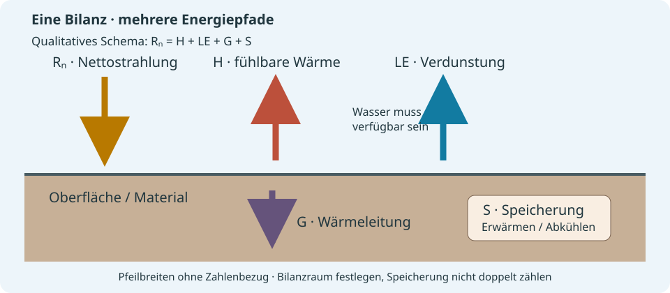

## Anschluss: Was erklärt unser Hotspot?

In der [Luftbild-/LST-Auswertung](modellierung_luftbild_lst.qmd) haben Sie warme und kühlere Oberflächen erkannt, Vergleichsflächen begründet und die Grenzen der Satellitenbeobachtung diskutiert. Jetzt folgt eine andere Frage: **Welcher physikalische Prozess könnte ein beobachtetes Muster erklären – und welche einzelne Maßnahme würde unter gleichen Wetterbedingungen etwas verändern?**

Wir übertragen eine Ihrer Fragen auf einen vorbereiteten Marburger Modellort: die Liebigstraße oder die Steinmühle. Falls Ihr Hotspot anderswo liegt, kennzeichnen Sie die Übertragung als **Analogie**. Sie modellieren dann einen ähnlichen Wirkungszusammenhang, nicht den ursprünglichen Ort.

{#fig-hotspot-prozess fig-alt="Vom beobachteten LST-Muster über eine physikalische Hypothese zu einem kontrollierten Ist-Maßnahmen-Vergleich."}

::: {.callout-important title="Was Sie in dieser Sitzung leisten"}

Sie formulieren und prüfen eine **Prozesshypothese**, nicht die Genauigkeit einer ganzen Stadtklimasimulation. Wir nutzen vorhandene **Oberflächenrechnungen**. Neue Modellläufe sind keine Voraussetzung; eine LES wird im Kurs nicht gestartet. Fehlt ein geeignetes Ergebnispaar, dokumentieren Sie eine begründete, ausdrücklich **noch ungeprüfte Prognose**.

:::

## Einstieg in KlimaCheck

Öffnen Sie [KlimaCheck](https://palm.spatialmodeling.org/) mit dem von der Lehrkraft bereitgestellten Zugang und wählen Sie den zugewiesenen Marburger Beispielort. Unter **Simulation → Assistent** erscheint der Lernpfad **Vom Hotspot zur Maßnahme** im Profil `bachelor_modellieren_2026`.

Der Assistent bleibt über der Karte sichtbar. Sie können ihn am Kopf verschieben oder verkleinern und über **Assistent** fortsetzen. **Auftrag** beschreibt die Aufgabe, **Weiter, wenn …** das Abschlusskriterium. Die Häkchen sind Ihre Selbstprüfung. Alle fünf Denk- und Dokumentationsschritte gehören zur Aufgabe; die Kartenknöpfe sind Hilfen. Das Digitalisieren einer eigenen Maßnahme ist optional.

Notizen bleiben innerhalb der geöffneten Seite erhalten. Laden Sie am Ende die **Lernnotiz** herunter, bevor Sie die Seite neu laden oder schließen. Sollte der Zugang noch nicht eingerichtet sein, können Sie die folgenden Schritte mit dem bereitgestellten Fallmaterial und eigenen Notizen bearbeiten.

## Kurzreader: Was PALM hier berechnet {#kurzreader}

::: {.panel-tabset}

### Ein Prozessmodell braucht mehr als ein Bild

[]{#ein-prozessmodell-braucht-mehr-als-ein-bild .course-anchor}

PALM ist ein modulares meteorologisches Modellsystem; seine LES beschreibt die räumliche Entwicklung von Luftströmung und thermodynamischen Größen. KlimaCheck bereitet dafür die Modelleingaben vor und stellt Ergebnisse dar. Die Karte allein ist noch keine Rechnung. [PALM-Dokumentation, Version 25.10.1](https://docs.palm-model.org/25.10.1/).

Das Modellgebiet wird in Zellen zerlegt. Gebäude, Gelände, Oberflächen und Pflanzen werden mit Eigenschaften belegt; Wetter und Anfangszustand ergänzen die Geometrie. Ein genaueres Raster ersetzt keine verlässlichen Material- und Wetterangaben. Der **Static Driver** hält räumliche Eingaben einschließlich Raumbezug fest. [PALM: Static Driver](https://docs.palm-model.org/25.10.1/Reference/LES_Model/IO-Files/Drivers/static/).

{#fig-palm-aufbau fig-alt="Gebäude und Baum im Modellgitter; Trennung von räumlichen Eingaben, Wetter und den zwei Rechenarten."}

### Wärme wird aufgenommen, abgegeben und gespeichert

[]{#wärme-wird-aufgenommen-abgegeben-und-gespeichert .course-anchor}

An einer Oberfläche verteilen sich Energiezufuhr und Energieabgabe auf verschiedene Prozesse. Als **vereinfachtes Lehrschema für eine horizontale Fläche ohne zusätzliche Wärmequellen** schreiben wir:

$$
R_n = H + LE + G + S.
$$

Dabei ist $R_n$ die Nettostrahlung, $H$ der fühlbare Wärmestrom zur Luft, $LE$ der latente Wärmestrom durch Verdunstung, $G$ die Wärmeleitung in tieferes Material und $S$ die verbleibende lokale Speicherung. Für dieses Schema zählen die drei Ströme von der Oberfläche weg positiv, Speicherung bei Erwärmung positiv. Die genaue Bilanzierung hängt von der betrachteten Schicht ab: **Wärmeleitung und Speicherung dürfen nicht doppelt gezählt werden.** Das Schema ist keine zusätzliche KlimaCheck-Rechenformel. PALM behandelt Oberflächen und Materialschichten differenzierter. [Resler et al. (2017)](https://gmd.copernicus.org/articles/10/3635/2017/).

{#fig-bilanz fig-alt="Nettostrahlung an einer horizontalen Oberfläche mit den Energiepfaden fühlbare Wärme H, Verdunstung LE, Wärmeleitung G und Speicherung S."}

Ein Baum verändert die Strahlung durch Abschattung; seine Krone nimmt Strahlung auf und streut beziehungsweise lässt einen Teil hindurch. Auch Gebäude und Oberflächen beeinflussen sich durch Reflexion und langwellige Strahlung. Darum ist eine schattige Aufenthaltsposition nicht durch die Temperatur des Bodens allein beschrieben. [Krč et al. (2021)](https://gmd.copernicus.org/articles/14/3095/2021/).

Entsiegelung kann Wasseraufnahme und Verdunstung ermöglichen; ob tatsächlich mehr Energie in Verdunstung geht, hängt unter anderem von Wasserverfügbarkeit und Vegetation ab. **„Grün“ ist keine feste Kühlleistung.** Diese Bedingung gehört in Ihre Hypothese.

### Oberflächenmodus und LES beantworten unterschiedliche Fragen

[]{#oberflächenmodus-und-les-beantworten-unterschiedliche-fragen .course-anchor}

PALM kann seine Oberflächen- und Strahlungsmodule bei ausgeschalteter atmosphärischer Dynamik betreiben. Dieser Weg liegt der hier verwendeten Oberflächenrechnung zugrunde. Die vollständige LES ergänzt die atmosphärische Entwicklung. [Maronga et al. (2020), insbesondere Oberflächenmodelle und Spinup](https://gmd.copernicus.org/articles/13/1335/2020/).

| Für diese Sitzung | Als mögliche spätere Vertiefung |
|---|---|
| **Oberflächenmodus:** Luft und Wind sind vorgegeben; wir vergleichen Oberflächen und Strahlungsumgebung relativ. | **LES:** Strömung und thermodynamische Felder werden zeitabhängig aufgelöst. |
| Frage: Wie verändert eine Maßnahme unter denselben Vorgaben die Oberflächen- oder Strahlungstemperatur? | Zusätzliche Frage: Wie verändern sich Luftströmung und Lufttemperatur räumlich? |
| Keine Aussage über eine vom Modell berechnete Luftabkühlung. | Zusätzliche Randbedingungen, Rechenaufwand und eigene Prüfung erforderlich. |

Dies ist die **Methodenwahl für diesen Kurs**, keine allgemeine Aussage, dass Oberflächenrechnungen reale Wetterereignisse vollständig abbilden. Der vorbereitete Idealtag ist insbesondere keine Rekonstruktion Ihrer Satellitenaufnahme.

### Vier Größen auseinanderhalten

[]{#vier-größen-auseinanderhalten .course-anchor}

| Größe | Was sie hier beschreibt | Was Sie daraus allein nicht schließen |
|---|---|---|
| Satelliten-LST | Thermischer Zustand der vom Sensor erfassten Oberfläche, mit dem Zeit- und Flächenbezug Ihres Produkts | Lokale Lufttemperatur oder Wärmebelastung einer Person |
| Modell-Oberflächentemperatur | Temperatur der modellierten Oberfläche im gewählten Fall und Zeitpunkt | Direkte Übereinstimmung mit einem anders aufgelösten Sommermittel |
| Mittlere Strahlungstemperatur $T_{mrt}$ | Zusammengefasste Strahlungsumgebung einer Person unter den jeweiligen Annahmen | Vollständige individuelle Wärmebeanspruchung |
| Lufttemperatur | Thermischer Zustand der Luft | Wird im hier verwendeten Oberflächenmodus nicht als räumliche Abkühlung neu berechnet |

Die Begriffe und Personenannahmen vertiefen Sie bei Bedarf im vorhandenen [Modellkonzept](modellierung_luftbild_lst.qmd) und im [Exkurs UTCI/PET](exkurs_stationen.qmd). In dieser Aufgabe genügen zunächst Oberflächen- und Strahlungstemperatur als getrennte Zielgrößen.

:::

## Arbeitsauftrag: fünf Schritte

Der folgende Ablauf ist ein **Planungsvorschlag für eine Sitzung von 90 Minuten**. Nutzen Sie den Kurzreader nach Bedarf; vertiefen Sie keine zusätzliche Modellart während der Sitzung.

::: {.panel-tabset}

### 1 · Hotspot und Frage festhalten

[]{#hotspot-und-frage-festhalten .course-anchor}

**Auftrag:** Wählen Sie einen Ihrer Hotspots. Notieren Sie Lage und Datenprodukt. Bei einer Einzelszene gehören Datum und Aufnahmezeit dazu; beim DLR-Sommermittel der Mittelungszeitraum und die gültigen Beobachtungen. Formulieren Sie eine Frage zur Oberfläche und kennzeichnen Sie eine etwaige Übertragung zur Steinmühle oder Liebigstraße als Analogie.

**Weiter, wenn:** Eine Beobachtung und eine offene Erklärungsfrage vorliegen. Ein Sommermittel wird nicht als einzelner heißer Nachmittag behandelt.

### 2 · Eine Prozesshypothese formulieren

[]{#eine-prozesshypothese-formulieren .course-anchor}

**Auftrag:** Ergänzen Sie: „Wir erwarten …, weil …; dagegen spräche …“. Ordnen Sie den vermuteten Prozess in @fig-bilanz ein. Prüfen Sie auf der Modellkarte, welche Geometrie, Materialien und Pflanzen tatsächlich repräsentiert sind.

**Weiter, wenn:** Ein Wirkungsweg und ein möglicher Gegenbefund genannt sind. Mindestens eine angenommene oder fehlende Modelleingabe ist dokumentiert.

### 3 · Genau eine Maßnahme wählen

[]{#genau-eine-maßnahme-wählen .course-anchor}

**Auftrag:** Wählen Sie **Baum** oder **Entsiegelung**, begründen Sie Lage und Mechanismus. Halten Sie Wetter, Datum, Zeitfenster und Gitter konstant. Optional erstellen Sie über den Assistenten eine eigene Kartenskizze; dafür wird eine Szenariokopie angelegt. Die Skizze erzeugt keine neuen Ergebnisse.

**Weiter, wenn:** Eine Maßnahme räumlich beschrieben und die erwartete Wirkung begründet ist. Bei Verdunstung ist die Wasserverfügbarkeit als Voraussetzung genannt.

### 4 · Vorhandenen Befund untersuchen – oder Prognose kennzeichnen

[]{#vorhandenen-befund-untersuchen-oder-prognose-kennzeichnen .course-anchor}

**Auftrag:** Wählen Sie im Assistenten einen fertigen **Ist-Zustand** und eine passende **vorhandene Maßnahme** im Oberflächenmodus. Die Lehrkraft benennt den kuratierten Fall. Nutzen Sie dieselbe Uhrzeit und dieselbe Zielgröße auf beiden Seiten. Prüfen Sie Unterschiede an mindestens einer sonnenexponierten und einer beschatteten Position. Halten Sie Fallnamen, Ort, Uhrzeit, Größe, Einheit und Vorzeichen fest:

$$
\Delta T = T_{\mathrm{Maßnahme}} - T_{\mathrm{Ist}}.
$$

Ein negatives $\Delta T$ bezeichnet für die betrachtete Temperatur eine geringere Temperatur im Maßnahmenfall. **Oberflächen- und Strahlungstemperatur werden getrennt verglichen.** Mauszeiger zeigen Werte und projizierte Koordinaten; Rechtsklick kopiert sie. Zum Digitalisieren kann die Zeigeranzeige abgeschaltet werden.

**Falls kein passendes Paar vorhanden ist:** Tragen Sie „Modellvergleich offen“ ein. Beschreiben Sie die erwartete Richtung und begründen Sie sie physikalisch. Geben Sie keine erfundenen Temperaturdifferenzen an und warten Sie in der Sitzung nicht auf einen neuen Lauf.

**Weiter, wenn:** Ein nachvollziehbarer Modellbefund **oder** eine klar gekennzeichnete ungeprüfte Prognose dokumentiert ist. Eine vorberechnete Variante wird nicht mit Ihrer neuen Kartenskizze verwechselt.

### 5 · Die Ausgangsfrage beantworten

[]{#die-ausgangsfrage-beantworten .course-anchor}

**Auftrag:** Trennen Sie drei Sätze: „Beobachtet haben wir …“, „Wir erklären dies durch …“, „Der Modellvergleich zeigt … / ist noch offen“. Nennen Sie zwei Grenzen und eine zusätzliche Beobachtung, die Ihre Erklärung prüfen könnte. Erklären Sie, warum das Modell die Satellitenkarte nicht einfach bestätigt.

**Weiter, wenn:** Schlussfolgerung, Grenzen und ein konkretes Prüfangebot vorliegen. Laden Sie Ihre Lernnotiz herunter.

:::

## Abgabe und gemeinsamer Abschluss

Geben Sie **eine kurze Lernnotiz mit einer beschrifteten Karte oder einem passenden Kartenausschnitt** ab. Sie enthält Hotspot/Datenbezug, Hypothese, einzelne Maßnahme, Befund oder Prognose, zwei Grenzen und einen Prüfungsvorschlag. Ein durchlaufender Rechenkern ist kein Erfolgskriterium.

Vergleichen Sie im Plenum: Was kommt aus Beobachtung, was aus Annahmen, was aus Prozessgleichungen? Diese Trennung nehmen wir in den nächsten Block zu [Starkniederschlag und Itzï](../index.qmd#starkniederschlag) mit.

::: {.callout-note title="Vorbereitung für die Lehrkraft" collapse="true"}

Den Kurszugängen das Profil `bachelor_modellieren_2026` und das gewünschte Marburger Projekt zuweisen; der Profilentwurf startet ohne Projekt- und Rechenfreigabe. Den schwebenden Lernpfad mit dem aktuellen KlimaCheck-Stand bereitstellen. Zugangsschlüssel werden separat verteilt und nicht in dieses öffentliche Kursrepository geschrieben.

Für OpenData-Steinmühle waren bei der rein lesenden Bestandsaufnahme am **19.11.2026** ein Ist-Fall und vier Maßnahmenfälle als abgeschlossen markiert. Als erste Kandidaten eignen sich `kc_opendata_steinmuehle_ist_ofl_3` zusammen mit `kc_opendata_steinmuehle_dc_baeume_ofl_3` oder `kc_opendata_steinmuehle_dc_entsiegelung_ofl_3`. Deren geprüfte Gitter-, Wetter- und Zeitmetadaten stimmen überein. Das ist **keine fachliche Ergebnisprüfung**: Vor der Sitzung Ausgaben, gemeinsamen Zeitpunkt und tatsächlich enthaltene Maßnahmen kontrollieren. Die Fallkennungen binden keine Modell- oder Ergebnisdateien in dieses Repository ein.

Falls Liebigstraße bis dahin ein geeignetes Oberflächenpaar hat, kann es stattdessen zugewiesen werden. Für die Sitzung ist keine neue LES erforderlich. Ohne vorbereitetes Paar bleibt der Prognoseweg vollständig bearbeitbar.

:::

## Geprüfte Lesehinweise

- Maronga, B., et al. (2020). *Overview of the PALM model system 6.0*. Geoscientific Model Development, 13, 1335–1372. [Artikel und vollständige Autorenliste](https://gmd.copernicus.org/articles/13/1335/2020/). Zur Orientierung in Modulen und Spinup; die Publikation beschreibt Version 6.0, nicht jeden späteren Programmstand.
- Resler, J., et al. (2017). *PALM-USM v1.0: A new urban surface model integrated into the PALM large-eddy simulation model*. Geoscientific Model Development, 10, 3635–3659. [Oberflächen- und Materialprozesse](https://gmd.copernicus.org/articles/10/3635/2017/).
- Krč, P., et al. (2021). *Radiative Transfer Model 3.0 integrated into the PALM model system 6.0*. Geoscientific Model Development, 14, 3095–3120. [Strahlung zwischen Gebäuden und Vegetation](https://gmd.copernicus.org/articles/14/3095/2021/).
- PALM Developers. (o. J.). *PALM Model System, Dokumentation 25.10.1*. [Modellübersicht](https://docs.palm-model.org/25.10.1/) und [Static Driver](https://docs.palm-model.org/25.10.1/Reference/LES_Model/IO-Files/Drivers/static/). Aufgerufen am 19. November 2026.

Alle drei Abbildungen sind eigene didaktische Schemazeichnungen; sie enthalten keine Messungen, Simulationsergebnisse oder übernommenen Publikationsgrafiken.
